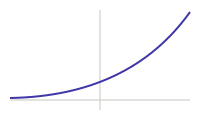

## Stepen i njegova svojstva

Za prirodan broj $n$ stepen $a^n$ je proizvod $n$ činilaca jednakih $a$. Za $a > 0$ pravila važe i za cele i racionalne izložioce, npr. $a^{1/2} = \sqrt{a}$.

:::formule
- $a^m \cdot a^n = a^{m+n}$
- $a^m : a^n = a^{m-n}$
- $(a^m)^n = a^{mn}$
- $(ab)^n = a^n b^n$
- $a^0 = 1$
- $a^{-n} = \frac{1}{a^n}$
:::

## Eksponencijalna funkcija

$f(x) = a^x$, gde je $a > 0$ i $a \ne 1$. Grafik uvek prolazi kroz $(0, 1)$.

Za $a > 1$ funkcija raste, za $0 < a < 1$ opada.

:::zapamti
$a^x > 0$ za svako $x$. Zato jednačina $2^x = -1$ nema rešenja.
:::

## Jednačine

Za $a > 0$, $a \ne 1$: $a^{f(x)} = a^{g(x)}$ važi tačno kad je $f(x) = g(x)$.

:::primer
$2^{x+1} = 8 = 2^3$, pa je $x + 1 = 3$ i $x = 2$.
:::

## Nejednačine

Za $a > 1$ znak ostaje: $a^{f(x)} > a^{g(x)}$ tačno kad je $f(x) > g(x)$.

:::zapamti
Za $0 < a < 1$ znak nejednakosti se okreće.
:::

:::primer
$\left(\frac{1}{2}\right)^x > 4 = \left(\frac{1}{2}\right)^{-2}$, osnova je manja od $1$, pa je $x < -2$.
:::
